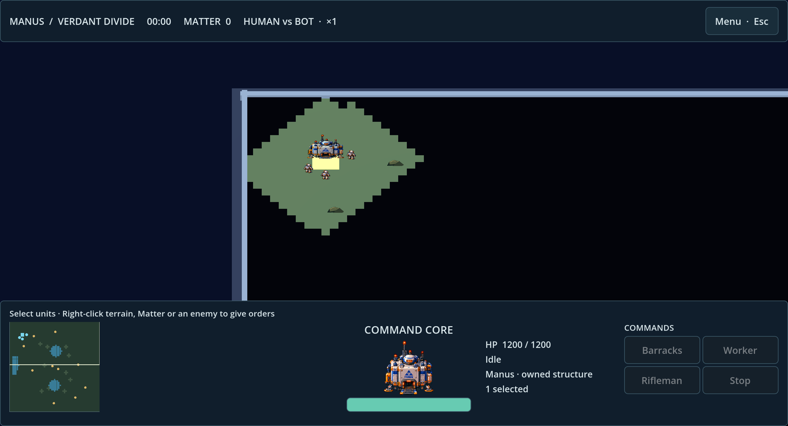
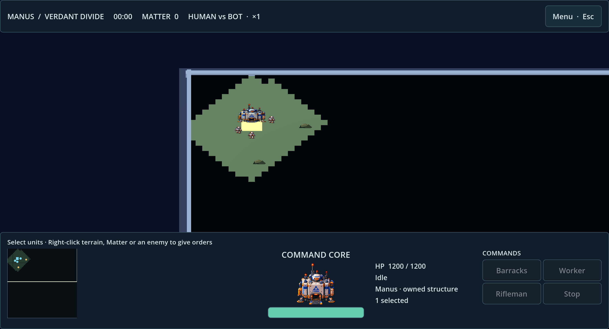
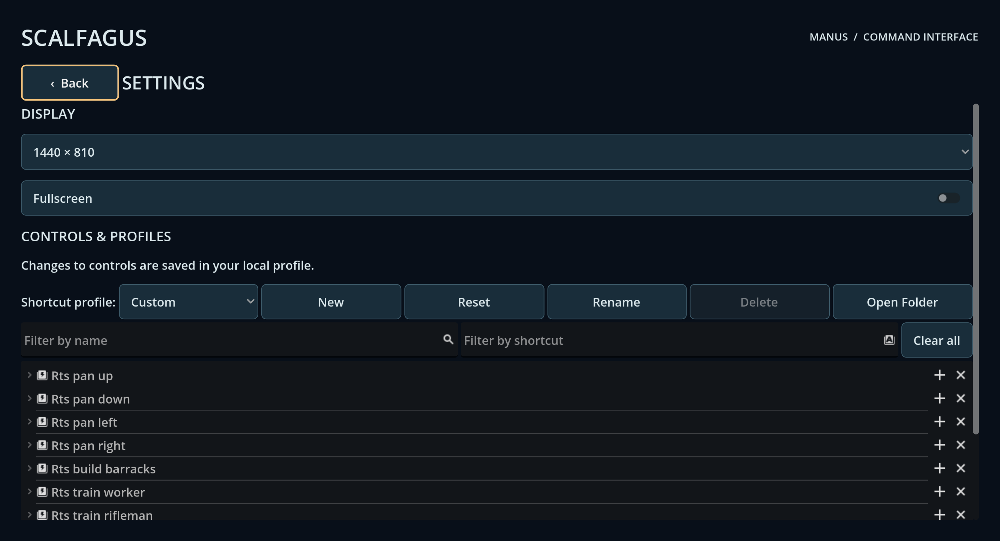

# Scalfagus — Full local main QA, 2026-10-12

> Overall: **PASS_WITH_WARNINGS** for automated local gates. Full external mouse gameplay is **BLOCKED**; foreign target execution is **NOT_RUN**. These are not release acceptance passes.

## Context and reproducibility

- Fresh `origin/main` baseline: `4767afdd5518cad4b2dfdab40ca54bbea82a323e`.
- QA branch: `codex/full-main-qa-20261012-4767afd`, separate clean worktree. Existing changes in the primary checkout were preserved.
- Tested code: `d04c049bcca6b66589aad7fca352e8fbf977f50a`. Later publication commits contain documentation, screenshots and logs only.
- Host: Apple M4, Darwin 27.0.0, arm64, macOS; Godot `4.7.2.stable.official.ed1daf0bf`, GUT 9.7.1, Node 24.21.0, PyYAML 6.0.3.
- Recorded QA gate runs: 18:48–19:05 CEST. Final gate run: `2026-10-12-190039-d04c049bc`. Origin was fetched again at 19:05 and remained at the baseline.
- Official 4.7.2 export templates were available. Addons were initialized with the pinned installer. No floating addon upgrades were made.
- Run `bash scripts/qa-local.sh` from a clean checkout with pinned Godot and the map Python environment. Additional commands and native render/export output are preserved below.

## Test matrix — actual results

Final gate logs are in `logs/local-qa/2026-10-12-190039-d04c049bc/`; supplemental evidence is in `logs/local-qa/main-4767afd/`.

| Command/scenario | Exit | Status | Evidence / scope |
|---|---:|---|---|
| `bash scripts/qa-local.sh` | 0 | PASS | `main-4767afd/qa-fixed-final.log`, all nine gates |
| `bash scripts/check-native-source.sh` | 0 | PASS | `native-source.log`; native source architecture |
| `bash scripts/check-smoke-coverage.sh` | 0 | PASS | `smoke-coverage.log`; all 24 root smoke fixtures included |
| `bash scripts/test-godot-qa-run.sh` | 0 | PASS | `runner-regression.log` |
| `bash scripts/install-godot-addons.sh --check` | 0 | PASS | `addon-inventory.log` |
| `bash scripts/check.sh` | 0 | PASS | `godot-smoke.log`; engine import, domain and UI fixtures |
| `bash scripts/check-gut.sh` | 0 | PASS | `gut.log`; 4/4 tests, 32 assertions |
| `bash scripts/check-keychain-persistence.sh` | 0 | PASS | `keychain-restart.log`; two real Godot processes, isolated profile |
| `bash scripts/check-map.sh` | 0 | PASS | `map.log`; YAML equals checked-in compiled JSON |
| `node --test architecture/examples/test_five_view_mapping.mjs` | 0 | PASS | `five-view.log`; 6/6 |
| Doctor | 0 | PASS | `main-4767afd/doctor.log` |
| Native menu/match pointer fixture | 0 | PASS | `native-menu_pointer_smoke-final.log`; real Viewport input injection |
| Native Save/Watch Replay fixture | 0 | PASS | `native-mirror_replay_ui_smoke-final.log` |
| Native command gateway fixture | 0 | PASS | `native-mirror_gateway_smoke.log` |
| Native UI render capture | 0 | PASS | `capture-final.log` and screenshots; OpenGL window rendering |
| 10 bot repeats, seed 42 | 0 | PASS | `bot-repeat10.log`; identical state hashes, Matter conserved |
| 10 full replay lifecycle repeats | 0 | PASS | `replay-repeat10.log`; identical terminal hashes |
| 100 bot matches, seeds 42–141 | 0 | PASS | `bot-sweep100.log`, `bot-sweep100.jsonl`; all conserved Matter |
| macOS export | 0 | PASS | `export-macos-final.log`; packaging |
| Installed macOS binary, 120-frame headless startup | 0 | PASS | `macos-runtime-final.log`; startup only |
| Windows export | 0 | PASS | `export-windows-final.log`; target execution NOT_RUN |
| Linux export | 0 | PASS | `export-linux-final.log`; target execution NOT_RUN |
| Web export | 0 | PASS | `export-web-final.log`; browser runtime NOT_RUN |
| External OS mouse: Worker → Matter → HQ → Barracks → Rifleman → attack → victory | n/a | BLOCKED | CUA window-control session repeatedly invalidated; not a reproduced game defect |
| Manual Keychain UI remap and restart | n/a | NOT_RUN | API/profile restart passes; manual dialog interaction not accepted |
| Embedded Game “Stretch to Fit” | n/a | NOT_RUN | Native standalone window tested instead |
| Signing/notarization, foreign target runtime, GUI stress FPS | n/a | NOT_RUN | No supporting runtime evidence |
| GitHub Actions | n/a | NOT_RUN | Local evidence does not establish CI status |

## Acceptance evidence

`godot-smoke.log` records PASS for timing (20 Hz), deterministic integrity, command gateway, human replay, 15 malformed replay schema cases, replay lifecycle/session/UI, match results, AStar, footprint, construction lifecycle, Verdant map, visuals, fog, physics LOS and group commands. Map/geometry fixtures cover 1660 Matter / 10 source nodes, HQ/Barracks 3×3 occupancy and 6×6 m collider scale with exterior access, 49 tree and 148 water colliders, and building collider lifecycle. Physics rays remain diagnostic; authoritative combat still uses the deterministic state.

Menu pointer fixtures cover Options → Back → Play, then selecting a Worker and right-clicking Matter. Command UI covers the sticky Back button, bottom HUD/portraits, opaque HQ directional fallback, production and pause/settings/resume. These tests inject native viewport events; they do not establish a full hardware-mouse match.

Replay UI tests cover Save Replay / Watch Replay, format 2 validation, incremental playback, restart/step controls, disabled destructive commands and safe corrupt-load handling. Rejected commands and ordered command history remain part of deterministic replay checks. Host-bound gateway validation passes; this is not proof of LAN transport.

Keychain restart harness changes Worker T → Y in a synthetic profile, writes through Keychain, starts a second Godot process and verifies Y persisted while project defaults remain T. Temporary project and synthetic userdata are cleaned up; the normal user's bindings are untouched.

Repeat bot hash: `86a2d047f18aeacaf9cda80f1d29c30da6ad9b312b9860c6ee0a962d45ec9f1a` (10 runs). Repeat full replay terminal hash: `26c9291fba9eb825389ba62ddc701147979a206813cd09e964fa31897cdb346f` (10 runs). The 100-seed batch completed in 53.558 seconds, 1.867 matches/sec, 44–56 wins, zero draws; this is a simulation measurement, not a balance conclusion or graphical stress benchmark.

Sprites, regions, directional mapping and faction icons pass asset checks. Existing valid atlas-row fallback prevents transparent human HQ views. Dedicated complete building artwork remains unfinished.

## Defects found and repaired

| ID / priority | Root cause and observed behavior | Repair / regression | Commit |
|---|---|---|---|
| QA-001 / P1 | Main's green check omitted existing menu pointer and command HUD fixtures. | Restore both fixtures; add coverage gate detecting omitted root smoke fixtures. Existing tests passed individually and in the full final run. | `9ea34bf9c4b2a870831b1b34b2f6956c99967888` |
| QA-002 / P1 validation gap | In-process binding tests did not prove profile persistence across process restart. | Add isolated two-process Keychain writer/reader gate with refusal to operate on ordinary userdata. | `9ea34bf9c4b2a870831b1b34b2f6956c99967888` |
| QA-003 / P1 | Native render showed all minimap terrain and deposits while the world was shrouded. Minimap drawing bypassed existing fog discovery/visibility. | Reuse world fog discovery for terrain and current human visibility for active sources; keep spectators omniscient. Extend fog fixture to compare world/minimap sources and unknown terrain. Full QA repeated after fix. | `d04c049bcca6b66589aad7fca352e8fbf977f50a` |

No canonical balance, costs, map data, autonomy, faction contracts, timing, authority or DEC-033–046 rules were changed.

Before minimap repair (engine render capture):

After repair, minimap discovery agrees with the world:

Settings capture:

## Warnings, blockers and untested scope

- Legacy prototype teardown still emits ObjectDB/RID leak warnings in affected fixtures. This run does not resolve those leaks; identify ownership with verbose engine diagnostics and add a targeted regression. Do not hide warnings or weaken checks.
- Vendored Keychain resource UID warnings fall back successfully to text paths on clean import. Addon inventory and restart acceptance pass. Resolve upstream/import metadata separately without silently editing pinned vendor code.
- CUA repeatedly reported that the native app changed even after re-querying it; bundle-ID lookup was ambiguous across installed copies. Full external mouse acceptance therefore remains BLOCKED. Native input-injected fixtures and renderer capture pass independently.
- H-H LAN/two-client gameplay is NOT_IMPLEMENTED and owner-deferred. The gateway is a building block, not a playable transport. If DEC-033 complete H-H delivery is required, this remains a release gate requiring renewed scope approval.
- Ridges/ramps/elevation parity and physical LOS combat authority are unfinished. Do not replace deterministic combat with renderer raycasts as part of a technical cleanup.
- ETH/ORG, UMU, advanced autonomy, FPP/TPP gameplay and post-MVP designs are outside this MAN mirror acceptance. Preserved experimental cameras are not current MVP gameplay proof.
- Dedicated human-building five-view artwork, full manual end-to-end GUI, GUI load/FPS measurements, embedded editor display, manual Keychain dialog, foreign runtime and distribution signing remain unaccepted.

## Publication and local artifacts

Sanitized text evidence removes ANSI escapes and local user home paths. No binary exports or real profiles are committed. The local `build/Scalfagus.app` and `~/Applications/Scalfagus.app` were updated from the final tested native export; primary build contains native macOS/Windows/Linux outputs, without copying the Web export into it. Existing retired Tauri archive and primary checkout edits were preserved.

Report: https://github.com/roktiw/scalfagus/blob/codex/full-main-qa-20261012-4767afd/docs/qa/reports/2026-10-12-4767afd-full-main.md

PR: https://github.com/roktiw/scalfagus/pull/29

Immutable report/evidence snapshot: https://github.com/roktiw/scalfagus/blob/aee308b/docs/qa/reports/2026-10-12-4767afd-full-main.md (before this link-only publication update).

## HANDOFF TO CHATGPT

PR: https://github.com/roktiw/scalfagus/pull/29. Report permalink: https://github.com/roktiw/scalfagus/blob/aee308b/docs/qa/reports/2026-10-12-4767afd-full-main.md. Final code tested: `d04c049bcca6b66589aad7fca352e8fbf977f50a`; publication snapshot: `aee308b` (docs/logs/screenshots only).

Baseline `4767afdd5518cad4b2dfdab40ca54bbea82a323e` → tested code `d04c049bcca6b66589aad7fca352e8fbf977f50a`, real macOS/Godot 4.7.2. Read the report and sanitized evidence above before changing behavior. All nine local automated gates pass; GUT 4/4 (32 assertions), five-view 6/6, native injected pointer/replay tests, all four export packages and Mac startup pass. Full external mouse gameplay is BLOCKED; foreign execution is NOT_RUN. Fixed missing UI regression coverage, verified isolated Keychain restart, and stopped minimap fog information leaks.

**Next work:** (1) P1: finish real mouse Human vs Bot acceptance through victory and record evidence; (2) P1: diagnose legacy scene teardown leaks; (3) P1: complete valid HQ/Barracks directional art and verify all views; (4) add meaningful graphical performance acceptance; (5) run Windows/Linux/Web artifacts on their actual targets. There is no newly reproduced P0 automated failure, but missing manual acceptance prevents a complete playable-release claim. LAN remains deferred; any renewed H-H scope or combat/elevation rule change needs the owner's decision. Do not weaken assertions, claim unrun CI, or confuse packaging with execution.
