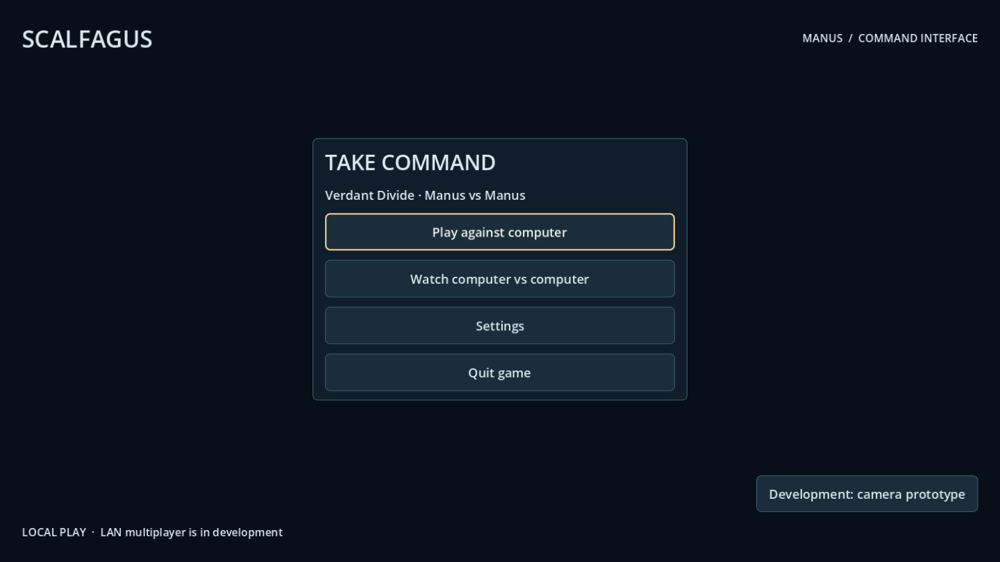
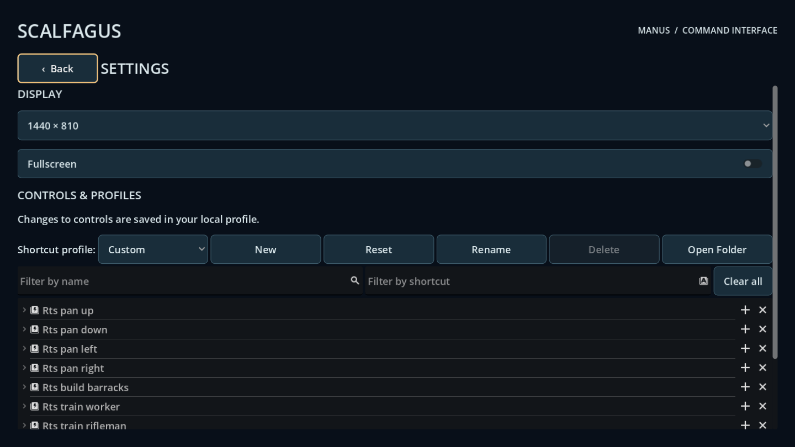
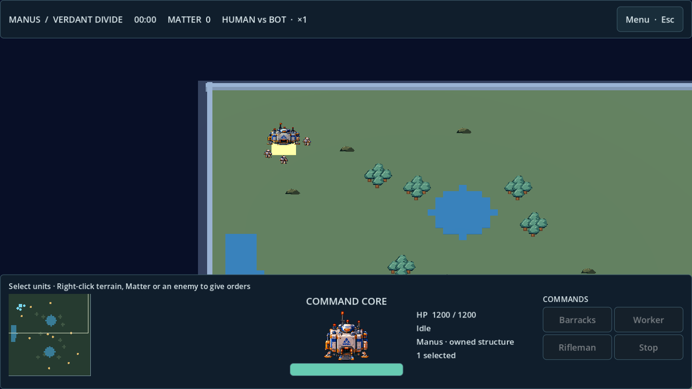
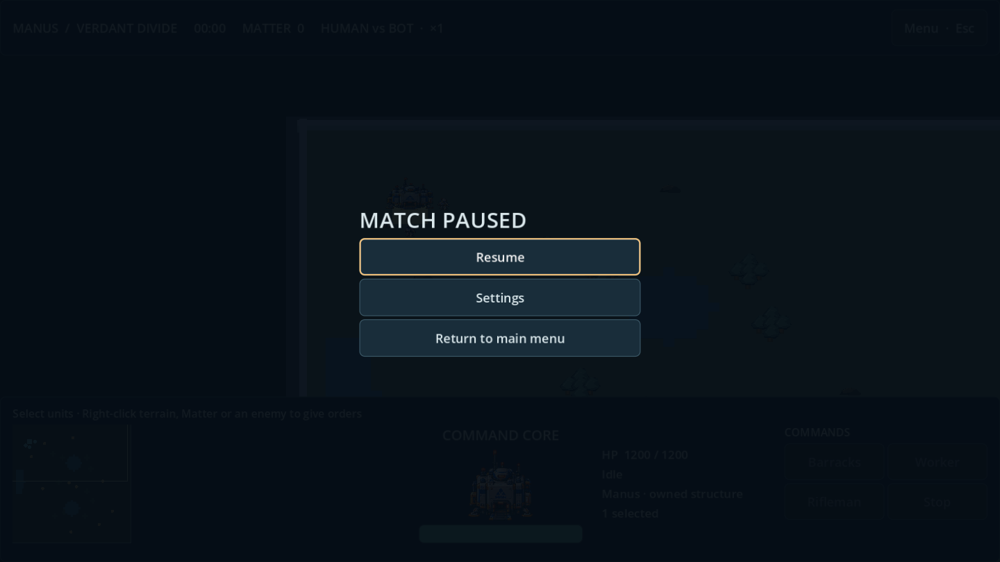

# Native menu, command HUD and MAN building visual repair

## Version and scope

- Branch: `codex/native-menu-command-hud`.
- Tested implementation: `bc787dea031564aa01fd4969f6b15c487f2e43f1`.
- Builds on the native development environment in PR #21.
- Host: macOS arm64, Godot 4.7.2 Standard, GUT 9.7.1.
- Presentation and UI changes only; authoritative match balance, resource accounting, map and collider geometry are unchanged.

## Root causes and implementation

### Settings return navigation

The old Options view forced a 990x660 stack plus a 920x470 Keychain editor, headings and controls. Its BACK button was the last item in an unbounded column, which could extend beyond the viewport.

The new native settings view puts Back in a fixed heading outside the scrollable display/control content. Escape returns when not consumed by a native editing dialog. Keyboard focus moves to Back on entry and returns to the main Play button on exit. Display resolution/fullscreen changes persist in a local ConfigFile; Keychain retains its existing profile editor and persistence. A regression checks Back containment at 960x540 and 1280x720 and its return transition.

### Main menu and match navigation

Primary choices are Play, Watch, Settings and Quit. The experimental camera scene is a secondary development action. A shared native Theme supplies readable typography, large primary targets and visible keyboard focus.

Escape or the in-match Menu button opens a pause overlay. Resume continues the current simulation; Settings opens the same settings screen and Back returns to the pause overlay. Returning to the main menu is explicit. The test verifies that paused frames do not advance the simulation and settings navigation preserves it.

### Bottom command deck

The deck uses a left minimap, central selected-unit portrait/HP, right-side stats and a command grid. A compact top strip shows Matter, match time, controller mode and speed. Contextual status replaces the previous multi-line hotkey banner.

The minimap draws actual compiled Verdant terrain, live sources, owned actors, visible enemies and the camera viewport. It does not use the legacy camera prototype's hardcoded map. Enemy markers respect the same visibility predicate as world rendering. Clicking focuses the camera. Group count, selected actor identity, HP, cargo, order and production/build progress come from authoritative state.

Command buttons enable according to unit type, Matter and production queue. Tooltips read current InputMap bindings rather than assume default keys. Production and Stop call `MirrorMatchState.issue_command`; Barracks enters the existing placement flow. UI panels consume mouse input so clicking HUD controls does not also issue world orders. The regression verifies an actual Worker production request and exact Matter debit.

### MAN base rendering

The nominal 128x640 lander atlas is not five complete views. Runtime alpha inspection confirms the substantial authored row is row 1; the other rows contain too little opaque artwork. Source-row fallback is `[1,1,1,1,1]` for that atlas. The prior camera sector selected almost-transparent rows, producing the speckles in the supplied screenshot.

`DirectionalSprite5` now caches per-source opaque coverage and uses a substantial existing row for incomplete views. All eight HQ sectors must render at least 500 opaque pixels in the new regression. The actual texture, directional sector logic, actor identity and 6x6m building collider remain. The same valid frame feeds the portrait. This makes the provisional building readable; it does not claim the missing rotation artwork has been authored. Dedicated complete HQ/Barracks direction sets remain an art task.

## Validation

| Scenario | Exit | Result |
|---|---:|---|
| Final `qa-local.sh` on tested commit | 0 | PASS |
| Native-source, runner regression, addon inventory | 0 each | PASS |
| Full Godot smoke suite, including new command UI regression | 0 | PASS |
| GUT | 0 | 4/4 tests, 32 assertions |
| Map consistency | 0 | PASS |
| Five-view reference mapping | 0 | 6/6 |
| Native OpenGL UI capture | 0 | Menu, settings, selected HQ deck, pause and in-match settings rendered |
| macOS export | 0 | PASS |
| Updated native macOS startup, 120 headless frames | 0 | PASS |

Logs: `logs/local-qa/ui-command-deck/` and `logs/local-qa/2026-10-12-121027-bc787dea0/`. Generated draft reports are superseded by this report. Negative runner fixtures intentionally print error lines; their expected rejection is a passing regression, not a production parse failure.

The final macOS export is installed at `build/Scalfagus.app` and `~/Applications/Scalfagus.app`; `build/Scalfagus.zip` is updated. Other platform outputs were not rebuilt for this UI change. Existing local formatting changes in `dev_menu.gd` are excluded from the PR.

## Rendered review evidence

## Remaining limits

- Complete dedicated building rotation artwork is still missing; current fallback is explicit and tested.
- Native GUI pointer automation and a full user-driven match remain separate from signal-based regression and engine-render capture acceptance.
- The inherited legacy renderer teardown warnings remain; no additional script failure was found in the final gates.
- LAN Human-Human and recorded command replay remain separate release tasks from the prior audit.

## HANDOFF TO CHATGPT

Review the rendered screenshots and this presentation implementation on `bc787dea031564aa01fd4969f6b15c487f2e43f1`. Settings Back is fixed; pause/settings/resume retains state. Bottom HUD reads live state and sends legal commands; minimap respects enemy visibility. HQ speckles came from incomplete source rows and now use a tested existing-art fallback. Local QA, GUT, mapping and macOS export/startup PASS. Next: author validated HQ/Barracks direction sets and run native pointer-driven gameplay/Keychain persistence acceptance. Keep domain authority and resource rules unchanged. PR/report links are added on publication.
