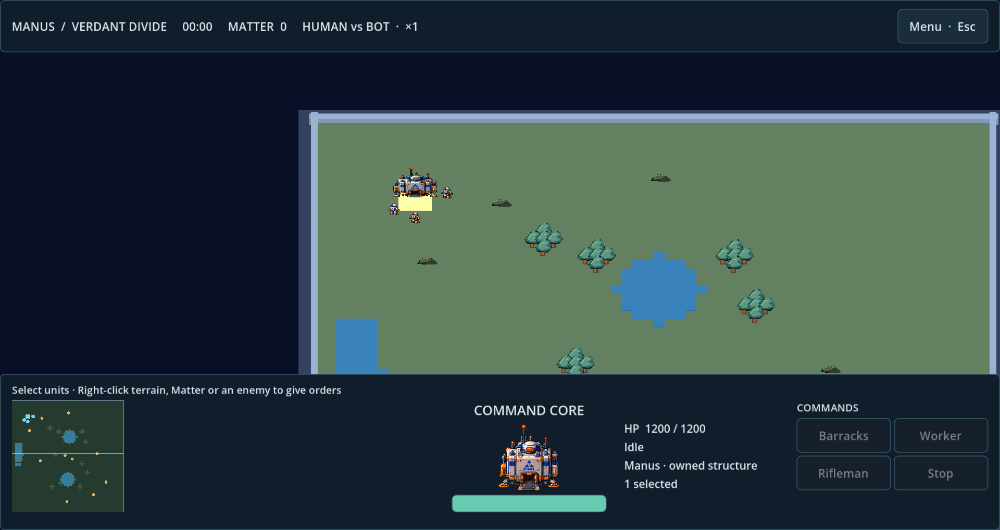

# PR20 local pointer audit and command UI reconciliation

## Versions

- Original PR #20 tested in a separate detached worktree: `0d6cc6a` (`origin/fix/mvp0-full-viewport-clickable-menu-20261012`).
- Corrected integrated code in PR #22: `aa7c033e5c893bb1efa30f644997b13e54488ec3`.
- Godot 4.7.2 Standard, Apple M4/macOS arm64, native OpenGL Compatibility renderer.

## Actual findings and results

| Run | Exit | Result | Log |
|---|---:|---|---|
| Original PR20 `check.sh` | 1 | FAIL at Options → Back pointer test | `pr20-check.log` |
| Original PR20 native, non-headless pointer test | 1 | FAIL at Back | `pr20-native-pointer.log` |
| Integrated native pointer test | 0 | PASS Options → Back → Play | `native-pointer-final.log` |
| Integrated native match pointer acceptance | 0 | PASS Worker selection and right-click Matter → legal gather order | same log |
| Final full QA on integrated SHA | 0 | PASS all gates; GUT 4/4, 32 assertions; mapping 6/6 | `qa-final.log` and individual gate logs |
| macOS export and installed-app startup | 0 each | PASS | `export-macos.log`, `runtime.log` |
| Native render capture | 0 | PASS screenshots generated | `captures.log` |

Evidence directory: `logs/local-qa/pr20-reconciliation/`; final individual gate logs: `logs/local-qa/2026-10-12-121643-aa7c033e5/`.

## Why original PR20 failed

PR20 places Back at the bottom of the content inside the settings ScrollContainer. The Keychain body makes that content taller than the visible scroll region. `Viewport.push_input` at the Back button's center does not activate the clipped control. The failure occurred on this Mac in headless and native-rendered runs; it is not a claim inferred from source inspection.

PR22's fixed settings heading puts Back outside the scrollable content. Retaining that structure makes the actual pointer regression pass. No assertion was removed or weakened to obtain the pointer PASS.

## Integrated changes

- Imported PR20's viewport-pointer regression, wrapped it in the fail-closed Godot runner and extended it to native Worker selection/right-click gathering.
- Kept the new menu/HUD/portraits and fixed Back from PR22.
- Removed forced 1440x810 window overrides, kept a 1280x720 logical base and enabled expanding aspect.
- Native top-level menu maximizes by default when no saved display preference exists; embedded play and in-match settings do not change the host window mode. User-selected saved window/fullscreen settings take precedence.
- Added 1/2/O menu fallback keys, explicit native button pointer behavior and embedded-mode guards for display settings.
- Replaced the obsolete visual regression requiring forced window size with checks for the logical viewport and absence of fixed native overrides.
- Updated `build/Scalfagus.app`, `build/Scalfagus.zip` and the installed native app.

## Limits and integration recommendation

Tests inject mouse events through Godot's real `Viewport.push_input` event path; they do not constitute an external hardware mouse session or a complete economy-to-victory match. Existing legacy RID/ObjectDB warnings and clean-worktree UID fallback warnings are recorded in logs.

PR20 should not be merged as an independent replacement for PR22's menu: that would reintroduce the clipped Back design. Its viewport/input changes and regression are already reconciled in PR22. Review PR21 → PR22 dependencies together and resolve around the integrated menu implementation. No LAN work was introduced.

## HANDOFF TO CHATGPT

Original [PR20](https://github.com/roktiw/scalfagus/pull/20) FAIL on Mac at Back. Integrated [PR22](https://github.com/roktiw/scalfagus/pull/22), code `aa7c033e5c893bb1efa30f644997b13e54488ec3`, PASS native menu pointer flow and Worker/Matter pointer orders, full QA, macOS packaging/startup. Preserve sticky Back and the bottom HUD. Next acceptance: full native user-driven Human-Bot match and Keychain remap/restart; LAN remains deferred. Report: `docs/qa/reports/2026-10-12-pr20-menu-pointer-reconciliation.md`.
